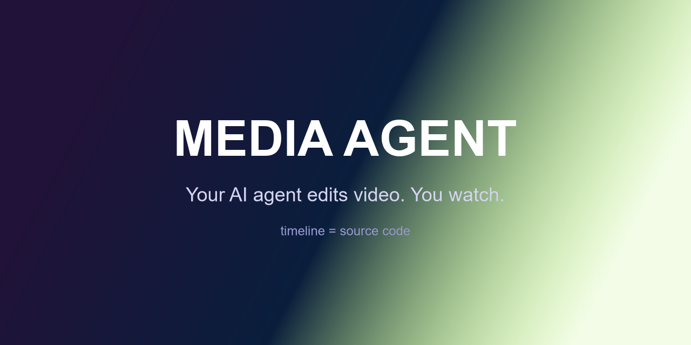

<div dir="rtl" align="center">



# Media Agent

**ایجنت هوش مصنوعی تو ویدیو ادیت می‌کنه. تو نگاه می‌کنی.**

یک تایم‌لاین به سبک پریمیر که ادیتورش یک مدل زبانی است — مدلِ خودت یا Claude Code.

[English](README.md) · [فارسی](README.fa.md)

[](LICENSE)
[](https://tauri.app)
[](CONTRIBUTING.md)

</div>

<div dir="rtl">

---

## این چیه؟

Claude Code کدبیس تو رو می‌خونه و فایل‌ها رو ادیت می‌کنه. **Media Agent فوتیج تو رو می‌خونه و تایم‌لاین رو ادیت می‌کنه.**

یک ادیتور دسکتاپ لوکال (Tauri 2، فوق سبک) حول یک ایده ساخته شده:
**تایم‌لاین = سورس‌کد.** پروژه یک JSON ادیت-دسیژن-لیست است؛ هر تغییری — درگ دستی تو، ایجنت چت داخلی، یا Claude Code از طریق MCP — از همون ابزارهای اعتبارسنجی‌شده و undo-پذیر رد می‌شه. ایجنت ویدیوت رو می‌چینه و تو همزمان نگاه می‌کنی، بعد همون ۲٪ آخر رو خودت دستی روی تایم‌لاین درست می‌کنی.

**غیرمخرب در طراحی:** فایل‌های خام هیچ‌وقت تغییر نمی‌کنن — EDL خودِ ادیت است و ffmpeg رندرش می‌کنه.

## ویژگی‌ها

- 🎬 **ادیت با ایجنت، دو مسیره** — چت داخلی BYOM (هر endpoint سازگار با OpenAI یا Anthropic؛ 9Router و Ollama هم پشتیبانی می‌شه) **و** سرور MCP استاندارد برای ایجنت‌های خارجی. Claude Code می‌تونه پروژهٔ بازِ تو رو ادیت کنه و تایم‌لاین رو زنده ببینی.
- 🧠 **پایپ‌لاین ادیت ویدیوی سخنران، کاملاً محلی** — ترنسکریپت کلمه‌به‌کلمه با Whisper محلی، تشخیص سکوت، بعد `remove_ranges`: یک فراخوان، کل جدول برش رو اعمال می‌کنه (اسنپ به مرز کلمات، بستن گپ، فید ۳۰ms صوتی، زوم ۱۰۸٪ یکی‌درمیان برای پوشش جامپ‌کات، نرمال‌سازی ‎−14 LUFS).
- 👀 **کنترل کیفیت با چشم** — ایجنت می‌تونه فریم‌هایی که استخراج می‌کنه رو **ببینه** و ادیت خودش رو تأیید کنه.
- 🛠️ **انسان کار ایجنت رو اصلاح می‌کنه** — درگ کلیپ، trim لبه‌ها، برش در پلی‌هِد، ripple delete، اسنپ مغناطیسی، میانبرهای کیبورد. ادیت دستی از همون ابزارها رد می‌شه، پس **undo برای انسان و ایجنت یکیه**.
- 🪶 **مدل‌های کوچیک شهروند درجه‌اون‌ان** — recipe های یک‌فراخوانی با پیش‌فرض عاقلانه + راهنمای تکنیک که ایجنت هر وقت خواست می‌خونه.
- 🪙 **بهینهٔ توکن در معماری** — نتایج فشرده، id های کوتاه، فشرده‌سازی history، prompt caching.
- 🖥️ **لوکال‌فرست و رایگان** — فقط ffmpeg و Whisper محلی. بدون اکانت ابری، بدون تلمتری، کلید API فقط روی سیستم خودت.

## شروع سریع

پیش‌نیاز: [Rust (MSVC)](https://rustup.rs)، Node 18+،
[ffmpeg روی PATH](https://www.gyan.dev/ffmpeg/builds/). برای ابزارهای گفتاری:
`pip install openai-whisper`.

```bash
git clone https://github.com/YOUR_USER/ai-video-editor.git
cd ai-video-editor
npm install
npm run tauri dev
```

توی ⚙ Settings مدلت رو انتخاب کن (پری‌ست برای OpenAI، Anthropic، OpenRouter،
9Router، Ollama، LM Studio)، دکمهٔ **Test connection** رو بزن و به ایجنت بگو:

> *«کلیپ‌هام رو توی D:\Videos پیدا کن، سکوت‌ها و کلمات اضافه رو ببُر،
> جامپ‌کات‌ها رو بپوشون، یک تایتل بذار، اکسپورت کن»*

### اتصال از Claude Code (MCP)

```json
{
  "mcpServers": {
    "ai-video-editor": {
      "command": "D:\\path\\to\\ai-video-editor\\src-tauri\\target\\debug\\app_media_creator.exe",
      "args": ["--mcp"]
    }
  }
}
```

اول اپ رو باز کن — ایجنت‌های خارجی همون پروژهٔ زنده رو ادیت می‌کنن.

## مشارکت

اییشو و PR خوش‌آمد — [CONTRIBUTING.md](CONTRIBUTING.md). این مخزن
[`AGENTS.md`](AGENTS.md) هم داره تا ایجنت‌های کدنویس هم بتونن مشارکت کنن.

## دونیشن 💜

اگه Media Agent به دردت خورد، از توسعه‌ش حمایت کن:

| | آدرس |
|---|---|
| TON | `UQA_YKoZvzl7bvRexWhF9CslqRjQ_AzkOA5sg-fJaijhD9DI` |
| USDT (BEP20) | `0x02d1537479c88f50B627A1e8D268C246Cc866b99` |
| USDT (TRC20) | `TTwRaiji2AxAJnxnAoAjse3x7oqQUfcSZM` |

## لایسنس

[MIT](LICENSE)
</div>
