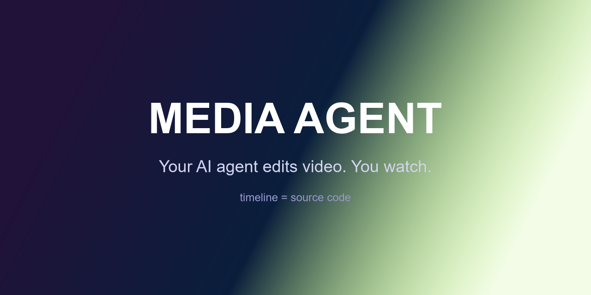

<div align="center">



# Media Agent

**Your AI agent edits video. You watch.**

A Premiere-like timeline where the editor is an LLM — yours or Claude Code's.

[English](README.md) · [فارسی](README.fa.md)

[](LICENSE)
[](https://tauri.app)
[](src-tauri)
[](CONTRIBUTING.md)
[](.github/workflows/ci.yml)

<!-- 📸 BEFORE PUSHING: record a 15-30s GIF of the app (agent editing the
     timeline live) and save it as docs/demo.gif — this single asset drives
     most of your stars. -->
<!--  -->

</div>

---

## What is this?

Claude Code reads your codebase and edits files. **Media Agent reads your footage and edits the timeline.**

A local-first desktop editor (Tauri 2, ~lightweight) built around one idea:
**the timeline is source code.** The project is a JSON edit-decision-list;
every change — by you dragging clips, by the built-in chat agent, or by
Claude Code over MCP — goes through the same validated, undoable tool calls.
The agent cuts your video while you watch it happen, then you fix the last
2% by hand, directly on the timeline.

```text
┌────────────────────────── Tauri App ──────────────────────────┐
│ Rust core:  EDL + ToolRegistry + undo/redo + ffmpeg engine    │
│ Control server:  ws://127.0.0.1:7333 (tool calls + changes)   │
│ Internal agent (BYOM): your key — OpenAI / Anthropic / Ollama │
│                / 9Router / OpenRouter / LM Studio / any       │
│ React UI: asset bin · preview · canvas timeline · agent chat  │
└───────────────────────────────────────────────────────────────┘
         ▲ WebSocket
   app.exe --mcp   (MCP stdio bridge)
   → Claude Code / ZCode / Cursor edit the SAME live project
```

**Non-destructive by design:** sources are never modified — the EDL is the
edit, ffmpeg renders it.

## Highlights

- 🎬 **Agent-driven editing, two ways** — built-in BYOM chat (bring any
  OpenAI-compatible endpoint or Anthropic) *and* a standard MCP server for
  external agents. Claude Code can drive your open project while you watch
  the timeline move.
- 🧠 **Talking-head recut pipeline, local** — word-level Whisper
  transcription, silence detection, then `remove_ranges`: one call applies a
  whole cut table (snapped to word boundaries, ripple close, 30 ms audio
  fades, alternating 108% punch-ins to mask jump cuts, −14 LUFS loudnorm).
- 👀 **Vision QA** — the agent can *look* at frames it extracts and verify
  its own edit (frame images go straight into the model conversation).
- 🛠️ **Human fixes the agent** — drag clips, drag edges to trim, split at
  playhead, ripple delete, magnetic snapping, keyboard shortcuts. Manual
  edits run through the same tools, so **undo is uniform for humans and
  agents**.
- 🪶 **Small models are first-class** — one-call recipes
  (`assemble_sequence`, `remove_ranges`, `mask_jump_cuts`) with sane
  defaults, plus technique guides the agent reads on demand
  (`skills_list` / `skill_read`).
- 🪙 **Token-efficient by architecture** — compact tool results, short ids,
  history compaction, prompt caching. Long sessions stay cheap.
- 🖥️ **Local-first & free** — ffmpeg + local Whisper only. No cloud
  account, no telemetry, your API key stays on your machine.

## Quick start

Prerequisites: [Rust (MSVC)](https://rustup.rs), Node 18+,
[ffmpeg + ffprobe on PATH](https://www.gyan.dev/ffmpeg/builds/).
Optional for speech tools: `pip install openai-whisper` (local Whisper).

```bash
git clone https://github.com/YOUR_USER/media-agent.git
cd media-agent
npm install
npm run tauri dev
```

Pick a model in ⚙ Settings (presets for OpenAI, Anthropic, OpenRouter,
9Router, Ollama, LM Studio — or any OpenAI-compatible base URL), hit
**Test connection**, and tell the agent:

> *“find my clips in D:\Videos, cut the silences and fillers, mask the jump
> cuts, add a title, export”*

### Use it from Claude Code (MCP)

```json
{
  "mcpServers": {
    "media-agent": {
      "command": "D:\\path\\to\\media-agent\\src-tauri\\target\\debug\\app_media_creator.exe",
      "args": ["--mcp"]
    }
  }
}
```

Start the app first — external agents edit the project you're watching.

## The tool surface (26)

| | Tool | What it does |
|---|---|---|
| 🔍 | `project_get` · `asset_list` | compact state (no file paths — token-lean) |
| 📁 | `asset_import` · `list_dir` · `find_media` | import media; agents locate files themselves |
| ✂️ | `clip_add` · `clip_cut` · `clip_move` · `clip_trim` · `clip_remove` | full manual-grade clip control (ripple option) |
| 🅣 | `text_add` · `text_update` · `text_remove` | overlays (relative-center positioning) |
| 🎙️ | `transcribe` · `silence_detect` | local Whisper word timestamps + silencedetect, with transcript **quality warnings** (hallucination loops, wrong model for language) |
| 🧩 | `remove_ranges` · `mask_jump_cuts` · `clip_zoom` · `assemble_sequence` | one-call recipes: cut tables, jump-cut masking, punch-ins, rough assembly |
| 👀 | `extract_frames` | frames as images for the model's own visual QA |
| ↩️ | `undo` · `redo` · `export_video` · `project_new` | history for everyone; ffmpeg export (zoom, fades, −14 LUFS) |
| 📚 | `skills_list` · `skill_read` | technique guides (`talking-head-recut`, `cuts-and-pace`, `captions-basic`) |

Everything is one EDL — see
[`src-tauri/src/edl/mod.rs`](src-tauri/src/edl/mod.rs). Export compiles to a
single ffmpeg command; no frame-by-frame rendering in app code.

## Design notes

- **One mutation authority.** UI drags, the internal agent, and MCP clients
  all call the same `tools::execute` → snapshot → validate → broadcast →
  autosave. Bad edits roll back; every edit is undoable by everyone.
- **Deterministic work stays local.** Whisper, silence detection, fades,
  loudness, frame extraction are tools — the model only makes *decisions*
  (which filler stays, which take is best). That's why small models can
  still edit well.
- **Safety rails learned the hard way:** cut snapping is bounded (±250 ms)
  so a hallucinated transcript can't explode a small cut into deleting the
  video; `remove_ranges` refuses to remove >60% of a clip without an
  explicit `allow_aggressive`.

## Roadmap

- [ ] **Wave 2 — creative layer:** HTML→video overlay bridge (animated
      titles, logos, word-synced captions via a deterministic renderer),
      bundled Vazirmatn font + SFX pack, `apple-glass` skill
- [ ] **Wave 3 — audio depth:** multiple audio tracks, per-clip volume,
      music ducking
- [ ] Bundled ffmpeg sidecar (no system install)
- [ ] Project save/open dialogs, recent projects
- [ ] Translations (help wanted!)

## Contributing

Issues and PRs welcome — see [CONTRIBUTING.md](CONTRIBUTING.md).
The repo carries an [`AGENTS.md`](AGENTS.md) so coding agents can contribute
too. Try it: open this repo in Claude Code and ask for a feature.

## Donate

If Media Agent saves you time, support its development 💜

<!-- 🪙 Replace the placeholder addresses below with your real wallets. -->
| | Address |
|---|---|
| BTC | `YOUR_BTC_ADDRESS` |
| ETH (ERC20) | `YOUR_ETH_ADDRESS` |
| USDT (TRC20) | `YOUR_USDT_TRC20_ADDRESS` |

<a href="https://github.com/sponsors/YOUR_USER"></a>

## License

[MIT](LICENSE) © The Media Agent Contributors
